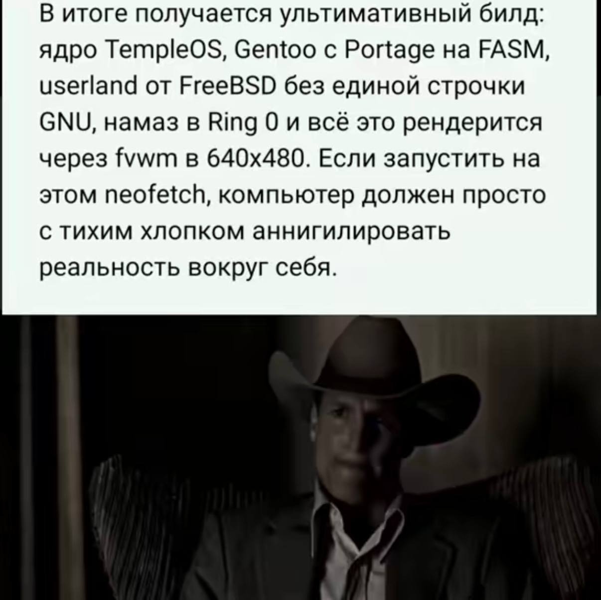

# SchizOS

**An experimental TempleOS-based operating system featuring FreeBSD userspace compatibility, an assembly-powered Gentoo package management subsystem, and an unreasonable amount of questionable engineering decisions.**

> **Why? Cause it's funny.**

## Genesis

*In the beginning, there was TempleOS.*

*And God saw that it was good.*

*Then someone decided to add FreeBSD, Gentoo, and an assembly-written package manager.*

*And God remained silent.*

## Overview

SchizOS is an experimental operating system project aiming to combine technologies that were never designed, intended, or reasonably expected to work together.

The ultimate goal is to build a system featuring:

- **TempleOS** as the actual kernel foundation.
- **FreeBSD** userland compatibility.
- **Gentoo Portage**, reimplemented in x86-64 assembly using FASM.
- **No GNU userland** in the target system.
- **Namaz in Ring 0**, because apparently even prayers require kernel privileges.
- **fvwm** running at 640×480.
- **neofetch**, so future generations may witness what we have done.

This is not a Linux distribution.

This is not a practical alternative to any existing operating system.

**This is what happens when free will goes unchecked.**

## The Origin

Every great operating system begins with a vision.

Ours began with a meme.



**Original meme:** Shared by [@neimxd](https://www.tiktok.com/@neimxd) on TikTok.

### English Translation

> The ultimate build: a TempleOS kernel, Gentoo with Portage written in FASM, FreeBSD userland without a single line of GNU code, namaz in Ring 0, and all of it rendered through fvwm at 640×480.
>
> If you run neofetch on this thing, the computer should simply annihilate the reality around it with a quiet pop.

### What Happened Next?

Someone saw this meme and decided to actually implement it.

We sincerely apologize for this misunderstanding.

**The original author made a joke. We made a repository.**

## Project Status

**Status: Pre-alpha / Awaiting Divine Intervention**

Currently, SchizOS is in its initial research and development phase.

No custom bootable SchizOS image, FreeBSD compatibility layer, or assembly-based package manager has been implemented yet.

### The Ten Commandments of SchizOS

1. Thou shalt have no other kernels before TempleOS.
2. Thou shalt not introduce GNU into thy userland.
3. Thou shalt keep thy builds reproducible.
4. Remember the 640×480 resolution, to keep it holy.
5. Honour thy kernel and thy bootloader.
6. Thou shalt not silently corrupt memory.
7. Thou shalt not commit untested code.
8. Thou shalt not steal another project's copyright.
9. Thou shalt not bear false witness about POSIX compliance.
10. Thou shalt not question why Portage is written in assembly.

### Development Roadmap

- [ ] Boot the original TempleOS kernel in QEMU.
- [ ] Create a reproducible custom TempleOS build.
- [ ] Integrate the first SchizOS kernel modifications.
- [ ] Implement an ELF64 loader.
- [ ] Introduce userspace isolation and a minimal syscall interface.
- [ ] Implement a minimal FreeBSD-compatible ABI.
- [ ] Execute the first FreeBSD userspace binary.
- [ ] Implement a minimal FASM-based package manager.
- [ ] Port the required graphical infrastructure.
- [ ] Run fvwm at 640×480.
- [ ] Run neofetch and ask God for forgiveness.

## Architecture

The intended architecture is:

```text
+--------------------------------------+
|              SchizOS                 |
|                                      |
|  fvwm / FreeBSD userland / neofetch   |
+--------------------------------------+
|       FreeBSD Compatibility Layer    |
|                                      |
|   ELF64 / Syscalls / Process Model   |
+--------------------------------------+
|         Modified TempleOS Kernel     |
|                                      |
|  Memory / Scheduler / Drivers / IPC  |
+--------------------------------------+
|              x86-64                  |
+--------------------------------------+
```

This diagram describes the intended architecture, not the current implementation.

## Development

Initial development targets QEMU on x86-64.

Development priorities are:

1. Reproducible builds.
2. Incremental kernel modifications.
3. Minimal compatibility implementations.
4. Automated testing wherever possible.
5. Preserving the original TempleOS code and its attribution.

Running SchizOS on physical hardware is not recommended.

**God may forgive your sins. Your hardware will not.**

## FAQ

### Is this a joke?

Yes.

### Is this a real operating system?

Right now? No.

In the future? Unfortunately, also yes.

### Why TempleOS?

Because Linux would make this too reasonable.

And because the Lord works in mysterious ways.

### Why FreeBSD?

Because apparently one operating system was not enough to test God's patience.

### Why rewrite Portage in assembly?

Because Python apparently made package management too accessible.

### Why namaz in Ring 0?

Because Ring 3 prayers apparently lack sufficient privileges.

### Is this production-ready?

Absolutely not.

### Should I use SchizOS?

No.

### Will it ever be stable?

Only God knows.

And He has declined to comment.

### Is this what Terry A. Davis intended?

We sincerely hope not.

### Is SchizOS blessed?

No official confirmation has been received.

### What happens if the kernel panics?

Pray.

## Contributing

Please read [CONTRIBUTING.md](CONTRIBUTING.md) before attempting to contribute.

We strongly advise against it.

**Forgive them, Father, for they know not what they compile.**

## Licensing

SchizOS is intended to contain components under different licenses.

Original SchizOS code is licensed as specified in [LICENSE](LICENSE). Third-party components retain their respective licenses and notices.

See [THIRD_PARTY_NOTICES.md](THIRD_PARTY_NOTICES.md) for details.

---

*SchizOS: God gave us free will. We used it to port FreeBSD to TempleOS.*

**Amen.**
